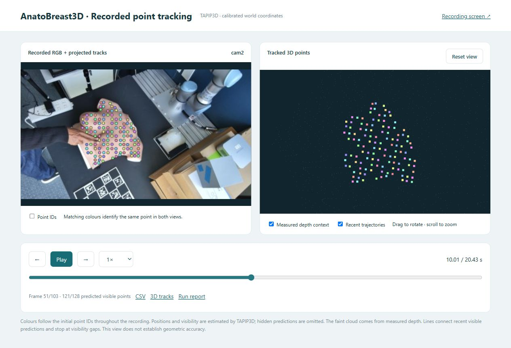

# Recorded point tracking with TAPIP3D

This branch follows points on a recorded silicone phantom in 3D using the
[authors' TAPIP3D implementation](https://github.com/zbw001/TAPIP3D). The same
point IDs continue through the recording using the model's overlapping
16-frame windows. The review screen shows projected tracks on recorded RGB
and the matching world-space trajectories side by side.



The full-phantom recording check processed 103 frames spanning 20.43 seconds,
with 128 initial points on an RTX 2070. This is a working integration test,
not an accuracy benchmark. Automatic segmentation can select only part of
the phantom; a supplied first-frame mask lets you choose the full surface.

## 1. Get this branch

Install Git and Python **3.11**, then open PowerShell in the folder where you
want the project and run:

```powershell
git clone --branch feature/tapip3d-point-tracking https://github.com/yohannes-taye/AnatoBreast3D.git
cd AnatoBreast3D
py -3.11 -m venv .venv
```

The commands below use the environment's Python directly, so PowerShell
activation settings do not need to be changed.

## 2. Install the tracking runtime

```powershell
.\.venv\Scripts\python.exe tools\setup_point_tracking.py
```

The setup helper installs the application dependencies and the tested Orbbec
Python binding, downloads TAPIP3D and its 309 MB released checkpoint, checks
the source revision and checkpoint hash, and writes a local configuration.
The first installation also downloads the CUDA PyTorch packages. The tested
machine has an NVIDIA RTX 2070 with 8 GB VRAM; CPU debugging is available with
`--device cpu`, but it will be much slower.

If the application environment and model downloads already exist, reuse them:

```powershell
python tools\setup_point_tracking.py --skip-deps --skip-downloads --upstream C:\models\TAPIP3D --checkpoint C:\models\tapip3d_final.pth
```

Use your existing environment's Python for that command. Workstation-specific
paths go into `configs/tracking/tapip3d.local.json`, which is excluded from Git.
The pinned model source is revision
`4cb7e69a1687f67d56ec3e506768f51f2c581b46`.

## 3. Supply segmentation weights or a first-frame mask

For automatic breast selection, copy the trained `breastseg.pth` from your
working AnatoBreast3D installation into `checkpoint/breastseg.pth`. The large
trained application checkpoint is not included in Git.

Alternatively, provide a binary PNG with the same dimensions as the first
RGB frame: white selects the phantom surface and black excludes everything
else. Add `--mask C:\path\phantom_mask.png` to the tracking command. This
option skips automatic segmentation and is useful when the breast detector
misses part of the silicone phantom. The mask only initializes queries; it
is not reapplied as a fixed boundary to moving points.

## 4. Copy a calibrated RGB-D recording

Keep the whole recording folder together:

```text
data/Replay/my_recording/
  session.json
  extrinsics.json
  cam1.bag
  cam2.bag
```

The session manifest maps camera IDs to bags. The recording's `extrinsics.json`
must map those cameras into the same world frame using `T_world_cam` in metres.
Aligned depth and matching colour intrinsics are required. A calibration from
a different camera arrangement cannot be reused. Recording-local calibration
takes precedence over the workstation configuration.

SDK bags can be replayed without the physical cameras connected. Legacy
camera folders containing `metadata.json`, `rgb/*.png`, and `depth/*.png` are
also supported. Static photogrammetry JPEGs, GLB meshes, and standalone PLY
clouds do not contain the temporal RGB-D observations this tracker needs.

## 5. Track the recording

Choose a camera ID from `session.json`. For the current two-camera setup:

```powershell
.\.venv\Scripts\python.exe -m anatomy_guided_recon3d.tracking.cli --session data\Replay\my_recording --camera cam2 --full-recording --sample-fps 5 --points 128 --out runs\point_tracking\my_recording_cam2
```

This samples source timestamps at approximately 5 fps across the clip, up to
300 frames. Full-recording mode uses a 384-pixel image side by default to
bound memory; `--max-side 512` retains more detail when GPU memory permits.
The source bags are unchanged. Each camera is processed separately; point
identities are not associated between different cameras yet.

For a short initial smoke test, omit `--full-recording` to use the existing
16-frame mode. `--prepare-only` writes the calibrated input without inference.

The recording screen also offers **Full recording** and **Short check** modes.
After a job completes, click **Review RGB + 3D playback** to open the linked
review screen. The command-line `--mask` option allows a manually selected
initial region; the recording screen currently uses automatic segmentation.

## 6. Open the review screen

Start the local viewer in the same project folder:

```powershell
.\.venv\Scripts\python.exe tools\serve_recon3d_viewer.py --host 127.0.0.1 --port 8767 --no-clean-existing
```

Open this address in a browser:

```text
http://127.0.0.1:8767/viewer/tracks.html?base=../runs/point_tracking/my_recording_cam2/
```

- Click **Play** or drag the timeline to inspect a specific frame.
- Choose **0.25×**, **0.5×**, **1×**, or **2×** playback speed.
- Enable **Point IDs** to identify individual tracks.
- Rotate and zoom the 3D view; use **Reset view** to return to the surface.
- Toggle measured depth context or recent trajectories.
- Hidden predictions are omitted. Trajectory lines stop at visibility gaps.

Colours identify the same initial query point in the RGB and 3D panels.
Projection uses the recording's camera calibration, so the 2D overlay is a
useful check for tracking drift and coordinate mistakes. It does not establish
ground-truth tracking accuracy.

## 7. Inspect or export the results

| File | Contents |
| --- | --- |
| `tracks.csv` | Frame, source timestamp, point ID, world XYZ in metres, predicted visibility |
| `tracks.npz` | Trajectory and visibility arrays, initial queries, timestamps, coordinate units |
| `result.json` | Browser review data, projected pixels, and source-frame image references |
| `tracking_report.json` | Counts, duration, visibility, displacement, checkpoint hash, method details |
| `effective_settings.json` | Exact runtime settings used for the run |
| `input.npz` | Prepared, rectified RGB-D sequence and camera matrices |

All generated recordings, checkpoints, and run outputs remain outside Git.
The uploaded screenshot is an example; full recordings are not uploaded.

## Verification and current scope

```powershell
.\.venv\Scripts\python.exe -m pytest tests\test_recorded_tracking.py tests\test_point_tracking.py tests\test_viewer_server.py tests\test_anatomy_guided_pipeline.py -q
```

The adapter loads the released network weights strictly and runs FP32 on the
RTX 2070. Exact PyTorch nearest-neighbour search replaces the unavailable
compiled pointops extension on Windows. Image encoding is bounded to small
batches while the upstream model handles the full timeline and overlapping
windows. The network is not restarted independently for each window.

This branch implements recorded tracking and review. Continuous live tracking,
cross-camera identity association, deformation registration, and accuracy
validation remain separate work. Reliable geometry requires correct depth
scale, aligned RGB-D, calibrated intrinsics, and fixed camera-to-world poses.

Upstream references: [TAPIP3D project](https://tapip3d.github.io/),
[code](https://github.com/zbw001/TAPIP3D),
[released model](https://huggingface.co/zbww/tapip3d), and
[Orbbec SDK installation](https://orbbec.github.io/pyorbbecsdk/source/2_installation/install_the_package.html).
