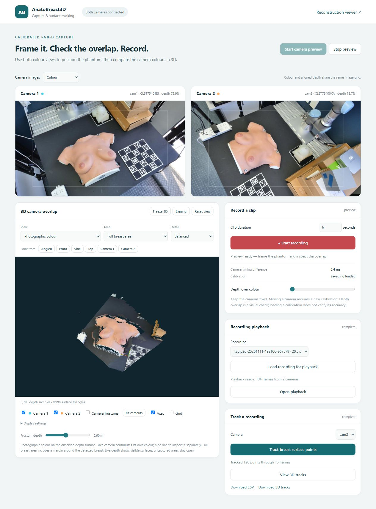
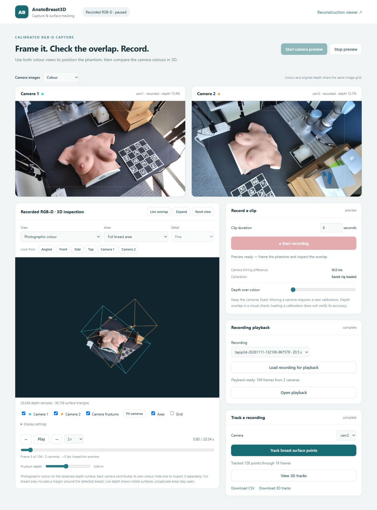
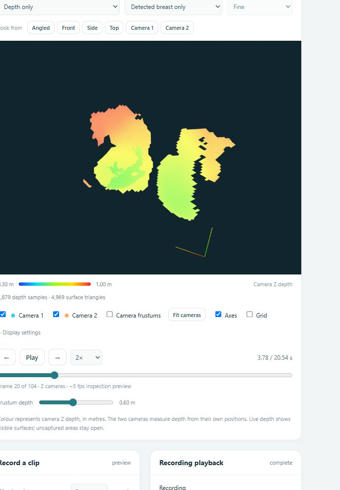
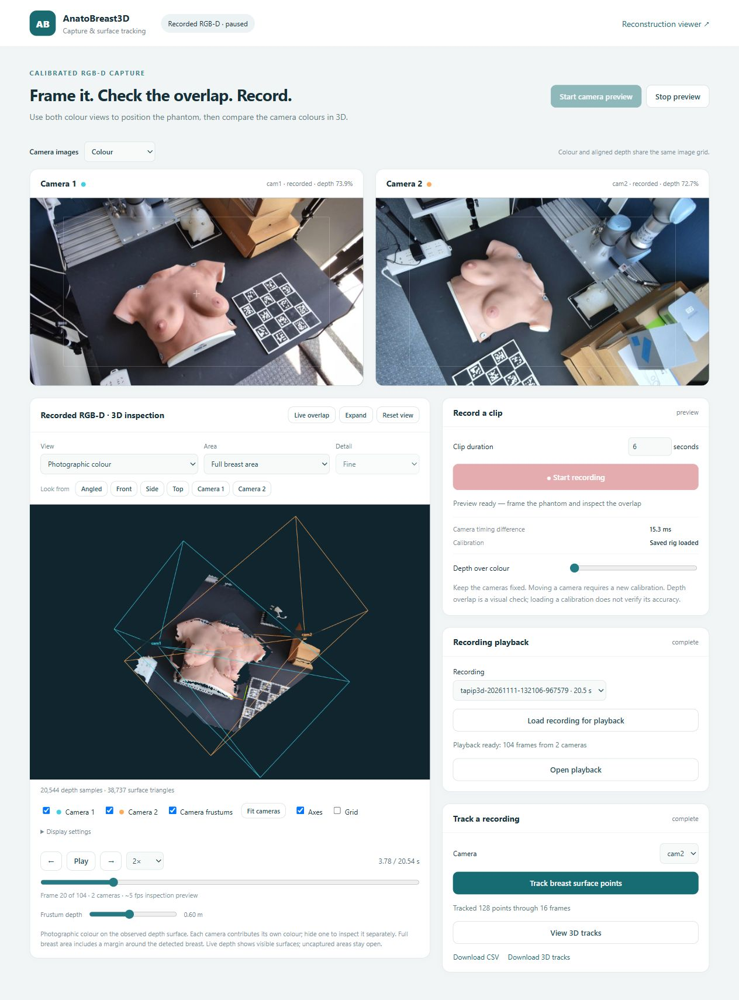

# Set up the recorder, 3D viewer and playback

This guide sets up the RGB-D recording screen, its 3D inspection views,
recording playback, and optional TAPIP3D surface tracking.



## Before you start

Use **Windows 10/11, 64-bit Python 3.11, Git, and an NVIDIA GPU** for the tested
tracking configuration. The development workstation uses an RTX 2070 with 8 GB
VRAM. Connect the Orbbec cameras through USB 3 ports and keep the mounts fixed.

You also need two files from your own setup:

- Your trained breast segmentation model: `checkpoint/breastseg.pth`.
- A calibration JSON containing each camera's **camera-to-world**
  `T_world_cam` matrix, with translations in **metres**.

The segmentation model, personal calibration, SDK recordings, downloaded
TAPIP3D weights, and generated playback caches are kept outside Git. The setup
helper downloads the authors' TAPIP3D checkpoint; it does not provide a trained
breast segmentation checkpoint.

## 1. Download the project

Open PowerShell in the folder where you want to keep the project:

```powershell
git clone https://github.com/yohannes-taye/AnatoBreast3D.git
cd AnatoBreast3D
```

If you already have a clone, pull the latest changes after saving your local work.

## 2. Create a Python environment

```powershell
py -3.11 -m venv .venv
.venv\Scripts\python.exe -m pip install --upgrade pip
```

The commands below use this environment directly, so activating it is optional.
Python 3.11 is intentional: this application pins NumPy 1.26 and Open3D 0.18.

## 3. Install the application and tracker

```powershell
.venv\Scripts\python.exe tools/setup_point_tracking.py
```

This installs the application and tracking dependencies, installs the tested
Orbbec Python wrapper, downloads the official TAPIP3D source at the tested
revision, verifies its approximately 309 MB checkpoint, and saves local paths.
The first installation downloads several large packages; let it finish.

Already have a working application environment? Run the helper with that
environment's Python and `--skip-base` instead of replacing its base packages.
The helper refuses to overwrite an existing local tracker configuration unless
you explicitly add `--overwrite-settings`.

The SDK package is **`pyorbbecsdk2==2.1.3`**, imported in Python as
`pyorbbecsdk`. The helper installs its bindings without the vendor's optional
demo dependencies so the application keeps one contrib OpenCV installation.
See the [official Orbbec installation guide](https://orbbec.github.io/pyorbbecsdk/source/2_installation/install_the_package.html)
if device permissions, native libraries, or Windows timestamp metadata need setup.

## 4. Add your breast segmentation model

Copy your trained model into:

```text
AnatoBreast3D/checkpoint/breastseg.pth
```

It must match `configs/breastseg/breastseg_b2_inplace.py`. Breast outlines,
breast-only views, and automatic tracking point selection use this model.

## 5. Find your cameras and add their calibration

Close Orbbec Viewer or any other program streaming from the same cameras, then run:

```powershell
.venv\Scripts\python.exe tools/configure_tracking_capture.py --list-cameras
```

Copy the printed serial numbers. Use camera IDs that already occur in your
calibration JSON. For example, replace the three capitalized values below:

```powershell
.venv\Scripts\python.exe tools/configure_tracking_capture.py --extrinsics "C:\path\YOUR_EXTRINSICS.json" --camera cam1=YOUR_FIRST_SERIAL --camera cam2=YOUR_SECOND_SERIAL
```

The helper copies your calibration to `configs/recon3d/extrinsics.local.json`
and creates `configs/recon3d/tracking_capture.local.yaml`. The app automatically
prefers this local profile. These files stay local, so another workstation can
have different cameras without editing the shared source.

**Need a new calibration?** Use the project's Charuco calibration workflow in
[QUICKSTART.md](QUICKSTART.md) and the calibration section of the main README.
Set the board dimensions, dictionary, square size, marker size, camera IDs and
serials to match the physical setup. Then run the helper above with its output.
Do not reuse another rig's matrices just because its cameras are the same model.

## 6. Check the setup

```powershell
.venv\Scripts\python.exe tools/check_recording_setup.py
```

You should see the installed packages, GPU, model paths and calibration marked
`OK`, followed by `Ready`. Resolve each `NEEDS SETUP` item before opening cameras.
This check reads settings; it does not start camera streams.

## 7. Open the recording screen

```powershell
.venv\Scripts\python.exe tools/serve_recon3d_viewer.py --host 127.0.0.1 --port 8766 --no-clean-existing
```

Leave that PowerShell window running. Open:

**http://127.0.0.1:8766/viewer/recording.html**

If the server reports a different port, use that port in the URL.
Click **Start camera preview** and wait for both images and the 3D surface.

## 8. Frame the phantom and inspect alignment

1. Position the phantom using the two colour images. Move the phantom, keeping
   the calibrated cameras fixed.
2. Try **Photographic colour**, **Shaded surface**, or **Colour point cloud**.
3. Use **Full breast area** for an enlarged region around the detected breast,
   **Detected breast only** for the segmentation mask, or **Whole scene**.
4. Switch to **Camera colours · alignment** or **Transparent overlap** to
   compare the cyan and orange surfaces. Hide either camera to inspect it alone.
5. Enable **Camera frustums**, then click **Fit cameras**. The pyramids show the
   configured camera positions, viewing directions and fields of view.
6. Use **Freeze 3D** to hold the geometry while the camera images remain live.



Use **Depth only** to inspect range, **Camera separation** to inspect nearby
cross-camera gaps, **Surface normals** to inspect orientation, and **Wireframe**
to see which depth samples are connected. **Display settings** controls point
size, opacity and the displayed depth range. **Expand** enlarges the 3D panel
where the browser supports fullscreen.



The frustums visualize the configured calibration; they do not validate it.
Correct intrinsics, depth-to-colour alignment, common camera extrinsics and
reasonable timing are all required. A persistent double surface is a reason to
check calibration and timing. The gap view reports nearest sampled surface
separation, affected by sampling and occlusion; it is not an accuracy certificate.

## 9. Record and play back a clip

1. Set **Clip duration**; start with six seconds.
2. Click **Start recording**. **Stop & save** ends it early.
3. Wait for **Recording saved**. The clip appears in the recording list.
4. Select it and click **Load recording for playback**. The first load prepares
   camera images and calibrated depth surfaces; progress is shown in the card.
5. Click **Open playback** when ready. Use **Play/Pause**, the timeline, the
   previous/next frame buttons, and **0.25× / 0.5× / 1× / 2×** speed.
6. Pause on a frame and change its 3D view, area, depth range or camera
   visibility. **Live overlap** returns to the current cameras.



Inspection playback samples approximately five frames per second and currently
prepares up to the first minute. Both recorded camera images and the displayed
3D surface use the same selected frame set. The original SDK bags retain the
captured streams; changing a view does not change them. Preparation can take
longer than the clip duration, especially with fine surfaces.

Recordings are under `data/Replay/`; previews, logs and compressed playback
caches are under `runs/point_tracking/`. SDK bags are large: the initial
six-second, two-camera test produced roughly 700 MB. Keep free disk space for
both recordings and their inspection caches.

## 10. Track surface points with TAPIP3D

Select a recording and its camera, then click **Track breast surface points**.
When complete, choose **View 3D tracks**. Use its frame slider and playback,
or download world-coordinate tracks as CSV/NPZ.

The default tracks up to 128 initialized surface points through 16 frames.
Tracking follows one camera over time; it does not merge point identities
between cameras. Continuous live deformation tracking is a later stage.
For method details, units and validation, see [POINT_TRACKING.md](POINT_TRACKING.md).

## Common fixes

| What you see | What to check |
| --- | --- |
| Browser cannot connect | Keep the server running and use the port it reports. |
| Cameras fail to open | Close other camera programs, check USB 3 connections, and compare configured serial numbers. |
| No breast surface | Check the segmentation checkpoint. Try Whole scene and a wider displayed depth range. |
| Surfaces stay doubled | Check camera poses, board dimensions and timing. Recalibrate after moving a camera. |
| Unusual timestamps | Follow Orbbec's Windows metadata setup instructions; the recorder enables SDK global timestamps. |
| Slow 3D updates | Choose Balanced/Fast, use a point-cloud view, or hide one camera. |
| Playback is preparing | Wait for its progress to finish; Open playback appears when the cache is ready. |
| Tracker has no CUDA | Check the NVIDIA driver and the environment printed by the setup checker. |

## What has been checked

The implementation was exercised with two physical Femto Bolt cameras and the
RTX 2070 workstation. Tests cover metric depth, camera transforms, frustum
rays, depth discontinuities, temporal pairing, visibility, and recording state.
The live views and synchronized playback were also checked in the browser.
These are engineering checks, not a validation of absolute geometric accuracy.
